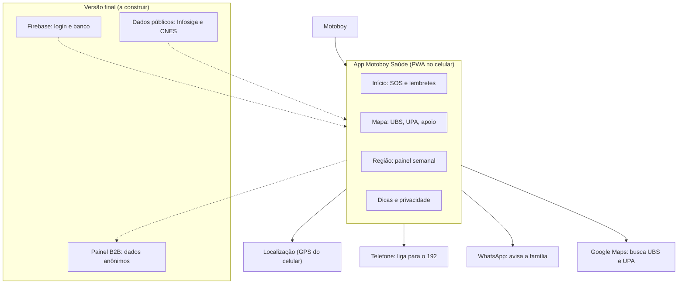

# Arquitetura da solução — Motoboy Saúde

## 1. Diagrama

Linhas contínuas: protótipo atual. Linhas tracejadas: versão final.

## 2. Componentes

| Camada | Componente | Função | Situação |
|---|---|---|---|
| Interface | App PWA (HTML, CSS e JavaScript) | Telas Início, Mapa, Região, Dicas e Privacidade | Protótipo pronto |
| Aparelho | Geolocalização do navegador | Posição para o botão de emergência | Protótipo pronto |
| Aparelho | Armazenamento local (`localStorage`) | Guarda consentimento, contato, placa e intervalo dos lembretes | Protótipo pronto |
| Aparelho | Som e vibração | Aviso dos lembretes de pausa e água | Protótipo pronto |
| Integração | Telefone (`tel:192`) | Abre a ligação para o SAMU | Protótipo pronto |
| Integração | WhatsApp (`wa.me`) | Mensagem pronta com localização e placa | Protótipo pronto |
| Integração | Google Maps (busca) | Encontra UBS, UPA, hospitais e pontos de apoio | Protótipo pronto |
| Dados | Infosiga SP (dados abertos) | Alimenta o painel semanal da região | Versão final |
| Dados | CNES / DATASUS | Lista oficial de unidades de saúde para o mapa | Versão final |
| Nuvem | Firebase (Authentication e Firestore) | Login e banco de dados | Versão final |
| Negócio | Painel B2B | Relatórios agregados e anônimos para plataformas de entrega | Versão final |

## 3. Fluxos principais

1. **Emergência:** o motoboy toca no botão, o app lê a localização (se autorizada), abre a ligação para o 192 e monta a mensagem de WhatsApp com a localização e a placa.
2. **Lembretes:** o app conta o intervalo escolhido e, ao zerar, avisa com mensagem, som e vibração, alternando entre água e pausa.
3. **Mapa:** o app abre o Google Maps com a busca já feita a partir da posição do usuário.
4. **Painel da região:** na versão final, uma rotina lê os dados abertos do Infosiga, agrega por região e semana e entrega ao app.

## 4. Decisões de projeto

- **PWA em vez de app nativo:** funciona no celular sem loja, é mais rápido de construir e atualizar.
- **Serviços sem chave de API:** telefone, WhatsApp e Google Maps por link reduzem custo e complexidade.
- **Privacidade por padrão:** no protótipo, nenhum dado sai do aparelho. Na versão final, os dados pessoais ficam no Firebase com regras de acesso, e o painel B2B recebe apenas dados agregados e anônimos. Veja [lgpd.md](lgpd.md).
- **Limitação conhecida:** os lembretes funcionam com o app aberto. Avisos com o app fechado exigem app nativo ou notificações push (fase 2).
- **Integração com o SAMU:** não existe API pública para acionar o SAMU automaticamente, então o app abre a ligação e o usuário confirma.
